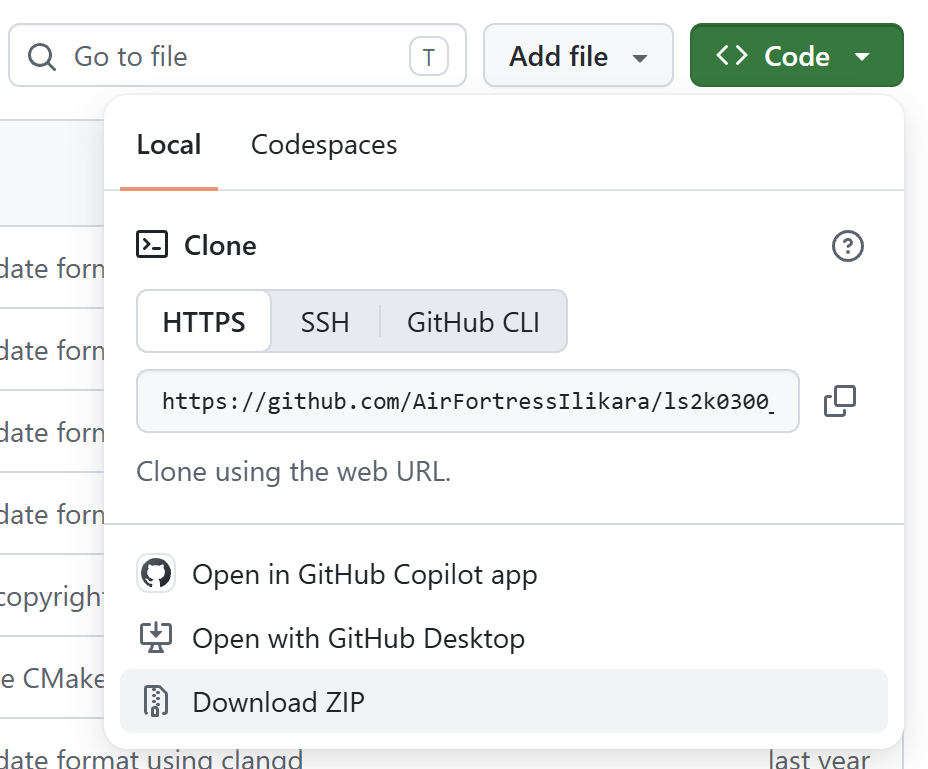
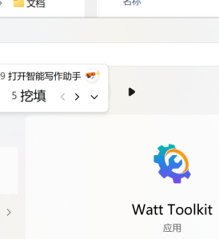

# NextPal

NextPal 是一个基于 STM32F103 的四足机器人控制项目，集成 FreeRTOS 多任务调度、舵机 PWM 驱动、逆运动学步态控制、蓝牙通信、超声波避障、OLED 显示以及手势/外部指令控制等功能。机器人采用 12 个舵机构成四肢运动系统，通过状态机切换站立、前进、后退、左右平移、左右转向和踏步等动作。

项目采用模块化结构：状态机负责解析控制指令和切换运动模式，步态模块生成脚尖轨迹，逆运动学模块将足端坐标转换为各关节角度，舵机控制模块完成 PWM 输出和平滑处理。当前版本重点优化了四足运动的动作表现，降低默认步幅和抬脚高度，加入更柔和的步态相位曲线，并对舵机输出进行滤波，使前进、后退和右转等动作更加清楚、稳定。

本工程适合作为嵌入式机器人、STM32 外设驱动、FreeRTOS 实践和四足步态控制的学习案例，也可继续扩展 IMU 自稳、视觉识别、远程控制和更复杂的运动策略。

---

## 📥 下载方法

### 方式一：直接下载（推荐）

点击页面右上角的 **`code`** 按钮，再点击 **`Download ZIP`** 即可下载整个项目；也可以 **Fork** 到自己仓库后再编辑。

### 方式二：GitHub 加载不出来时

如果网页打不开或下载慢，安装 **WattToolkit** 加速器（免费好用），或者使用梯子 / VPN（收费）。

安装时勾选 **Steam** 和 **GitHub** 加速选项：

